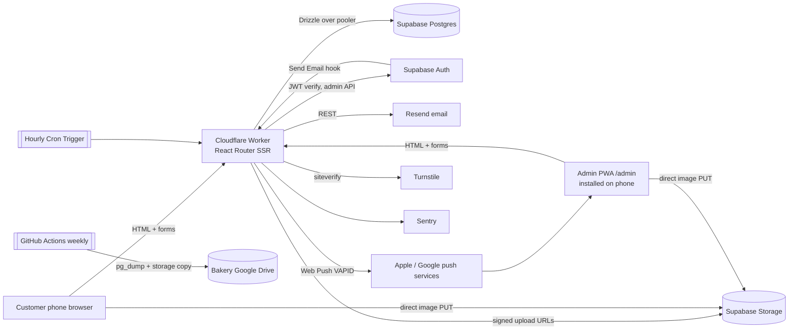

# Architecture — Aux petits bonheurs

Updated: 2026-11-10 (feature-spec consolidation) · Rigor: standard · ADRs: `docs/architecture/adr/` (ADR-0001 stack)
Companions: `data-model.md`, `api/contracts.md`. Requirements: `docs/product/prd.md` (FR/NFR IDs cited inline).

## Overview

One deployable app: a React Router (framework mode) Worker serves the bilingual customer site and the private `/admin` PWA from the same codebase, renders every page on the server, and talks to one Supabase project per environment for data, auth and files. Email goes through an outbox table so an order is saved even when email fails (FR-074). One hourly cron trigger runs all time-based rules in Mauritius time. Everything runs on free commercial plans (NFR-009, ADR-0001).

**Scale assumptions.** Under 1k orders/month, a few hundred visitors/day, 1–5 admins, ~100 emails/day peak, ~1 GB photos. No realtime need ("within seconds" in admin is met by push + page load). Uptime: best effort on free plans (NFR-005).

## Stack
| Layer | Choice | ADR |
|---|---|---|
| Frontend + server | React Router v8 framework mode, SSR, loaders/actions; React 19; Tailwind 4 + shadcn/ui | ADR-0001 |
| Runtime / hosting | Cloudflare Workers (free), envs `staging` + `production`, deployed by GitHub Actions | ADR-0001, ADR-0002 |
| Database / ORM | Supabase Postgres (free) via Drizzle + `postgres` driver on the transaction pooler | ADR-0001 |
| Auth | Supabase Auth (password, magic link, reset) via `@supabase/ssr` cookies; roles in our `admin` table | ADR-0001 |
| Files | Supabase Storage, browser-side compression, signed upload URLs | ADR-0001 |
| Email / push | Resend + React Email (EN/FR), outbox + retry; Web Push (VAPID) | ADR-0001 |
| Bot / abuse | Cloudflare Turnstile; Postgres fixed-window rate limits | this doc |
| Observability | Sentry (`@sentry/cloudflare`), Workers Logs | ADR-0001 |
| Tests | Vitest (domain + server), Playwright (journeys) | ADR-0001 |

## Rendering strategy
| Route group | Strategy | Cache | Why |
|---|---|---|---|
| Customer pages (`/`, `/menu`, `/menu/:slug`, `/gallery`, `/about`, `/contact`, `/faq`), with `/fr/...` twins | SSR per request on the Worker | HTML `no-store` at the edge for now; hashed assets `immutable` 1 year | Sold-out, blocked dates and promotion start/end must show at once (FR-016, FR-059); content volume is tiny, so SSR cost is low |
| Basket + checkout (`/basket`), custom request (`/custom-cake`) | SSR + progressive enhancement; React Router `<Form>` posts to actions | `no-store` | Works without JS; JS adds the live price and the date picker |
| Tracking (`/t/:token`) | SSR | `no-store`, `noindex`, `Referrer-Policy: no-referrer` | Private bearer link (FR-026) |
| Account (`/account/*`) | SSR, authenticated | `private, no-store` | Personal data |
| Admin PWA (`/admin/*`) | SSR first load, then client navigations (React Router data APIs) | `private, no-store` | Phone app feel; installable; still server-authorised on every loader/action |
| Resource routes (`/hooks/*`, `/healthz`, `/admin/sw.js`, `/admin/manifest.webmanifest`, CSV export) | Server only | per route | Non-HTML endpoints |

**Client JS.** React Router hydrates every route; the shared runtime (React + router) is ~90 kB gz, leaving ~80 kB under the 170 kB budget (project.yaml). Rules: no client-only data fetching on customer pages; heavy widgets (photo carousel, HEIC decoder, image compressor, drag-reorder) are `lazy()`-loaded on interaction; Sentry's browser SDK ships only in the admin bundle. `performance-engineer` checks the per-route budget in CI with the build manifest.

**Edge cache later.** If TTFB or Worker CPU becomes a problem, add a 60 s Cache API layer for anonymous menu/home HTML with purge on menu/promotion/availability writes. Not needed at launch.

## Code organisation
Modular monolith inside `src/` (`paths.code_root`):
```
src/
  workers/app.ts            fetch -> React Router; scheduled -> app/jobs/dispatch
  app/
    routes.ts               route table (customer, /fr twins, /admin, hooks)
    routes/site/*           customer route modules (loader/action + view)
    routes/account/*        customer account
    routes/admin/*          admin PWA route modules
    routes/hooks/*          webhook + resource routes
    domain/                 PURE rules: money, time, availability, pricing, promotions,
                            status, quote, prep-list, whatsapp, order-number, phone
    server/                 *.server.ts only (never bundled to the browser)
      env.server.ts         zod-validated bindings and secrets
      db.server.ts          per-request Drizzle client
      auth.server.ts        requireAdmin / requireOwner / requireCustomer / optionalCustomer
      repos/                queries per aggregate (orders, catalogue, customers, settings ...)
      services/             use cases: placeOrder, submitCustomRequest, approveOrder,
                            sendQuote, acceptQuote, advanceStatus, editOrder, inviteAdmin ...
      email/                outbox writer, sender, React Email templates (en/fr)
      push.server.ts, storage.server.ts, turnstile.server.ts, rate-limit.server.ts
    jobs/                   cron jobs (one file each) + dispatch.ts
    db/                     schema.ts barrel + tables/*
    i18n/                   en.json, fr.json, i18next setup
    components/ui           shadcn primitives; features/<feature>/ for feature UI
    lib/                    locale/format helpers (existing)
  public/admin/             sw.js, icons (PWA)
```
**Module boundaries** (enforced by ESLint `no-restricted-imports` and review):
- `app/domain` imports nothing from `db`, `server`, `react`, `react-router` or the network. Functions take plain data and an injected `now: Date`; they return values or typed `DomainError`s. This is where FR-011..017, FR-027, FR-030..033, FR-051..056, FR-060, FR-073, FR-075 live, with ≥ 90 % unit coverage. The prototype `prototypes/apb-v1/src/domain` is a **reference to re-implement test-first, never imported** or copied wholesale.
- Route modules stay thin: parse input (zod) → guard (auth/role/rate limit/Turnstile) → call one service → return data or a typed error. No SQL in routes.
- Services own transactions: domain decision → repo writes → order_event → outbox rows, all in one `db.transaction`. Side effects (send email, push) run **after commit** via `ctx.waitUntil`.
- The browser recomputes prices with the same `domain/pricing.ts` for the live price only; the server result is authoritative (FR-011, R5).

## Data
- **System of record:** Postgres (data-model.md). No cache, queue or search service: volumes don't justify them. Queues are tables (`email_outbox`, `job_run`); search is `ILIKE`.
- **Connection:** each request creates a `postgres` client (`max: 1`, `prepare: false`) to the Supavisor transaction pooler (port 6543) and closes it in `waitUntil`. Supabase region: the closest available to Mauritius (proposed `ap-south-1`, Mumbai; confirm by measuring at setup). Enable Workers **Smart Placement** so the Worker runs near the database for multi-query pages. When the deploy injects a Hyperdrive binding (`env.HYPERDRIVE.connectionString`, ADR-0003) the client uses it instead of `DATABASE_URL`, which stays the fallback. Staging deploys leave the binding out unless a manual deploy asks for it (ADR-0003 amendment).
- **Basket:** stored in the cookie `apb_basket` (compact JSON of product id, choices, quantity, message; max 10 lines, ≤ 4000 bytes), so the basket count and `/basket` render on the server and work without JS. Since ADR-0004 the browser writes it too (not HttpOnly; add, quantity and remove make no network call) and the basket renders from the public menu cached in localStorage (`GET /api/menu`, ETag). It holds no prices; the server treats it as untrusted and re-prices on every render and on submit.
- **Files:** bucket `public-images` (products, gallery, promotions, hero; public CDN URLs, long cache, versioned paths) and bucket `request-photos` (private; signed read URLs, 10 min).
- **Image pipeline** (FR-029, FR-062, NFR-001/009): browser checks type and ≤ 10 MB → decodes (HEIC via lazily loaded `heic2any` when needed) → resizes to 1600 px and 640 px long edge, WebP (JPEG fallback) ≤ 300 kB target (NFR-001/009, brief) → asks the action for signed upload URLs (auth/Turnstile, count ≤ 5, declared type/size) → PUTs directly to Storage → submits paths with the form. The server verifies each object exists under the issued prefix, has an allowed MIME and ≤ 1 MB, else rejects. Bucket-level MIME and size limits back this up. No image bytes pass through the Worker (CPU limit). Orphaned uploads are purged by cron after 24 h.

**Key journey: place a website order (FR-015, FR-023, FR-024, FR-074)**
```mermaid
sequenceDiagram
  participant B as Browser
  participant W as Worker action /basket
  participant D as domain/*
  participant P as Postgres
  participant R as Resend
  participant A as Admin push
  B->>W: POST basket, date, window, details, idempotencyKey, turnstileToken
  W->>W: zod parse, rate limit, Turnstile verify
  W->>P: load products/options/promotions/settings/blocked dates
  W->>D: checkAvailability(now MU), priceBasket(), applyPromotions()
  alt date unavailable or price differs from client's displayed total
    W-->>B: 409 DATE_UNAVAILABLE / PRICE_CHANGED (+ new prices)
  else ok
    W->>P: BEGIN; existing idempotency_key? -> return it
    W->>P: upsert customer; counter+1 (APB-n); insert order, items (copied prices), event, outbox rows; COMMIT
    W-->>B: redirect /order/:token/confirmed
    W-)R: waitUntil: send "Order received" (outbox -> sent or retry)
    W-)A: waitUntil: push + email alert to opted-in admins
  end
```

## Auth & authorisation model
- **One Supabase Auth user pool** for customers and admins; an auth user is either an admin (row in `admin`) or a customer (row in `customer.auth_user_id`), never both.
- **Session:** `@supabase/ssr` HttpOnly, Secure, SameSite=Lax cookies; server verifies the access token with `auth.getClaims()` (asymmetric JWT signing keys, verified locally via JWKS, no network call per request). Refresh happens server-side and rewrites cookies.
- **Guards** in `auth.server.ts`, called at the top of **every** loader and action (never by layout alone):
  - `requireAdmin(request, { role?: 'owner' })` → valid claims → `admin` row exists and `active` → role matches → **session age ≤ 30 days**, where age = now − sign-in time from the JWT `amr` claim; otherwise sign out and redirect to `/admin/login` (FR-040, FR-041). Updates `last_sign_in_at` at sign-in.
  - `requireCustomer` / `optionalCustomer` for `/account/*` and checkout prefill. A customer session reaching any `/admin` route (except login, invite, forgot, reset) is redirected to `/admin/login` like any non-admin, and no admin data is returned (FR-039; decision 2026-11-10, replaces the earlier 404). `requireCustomer` also requires a confirmed email (`email_confirmed_at`).
  - **Linking guest orders (FR-038):** `saveDetails` and `signUp` take no password and only create an unconfirmed auth user with a random discarded password; the customer chooses a password only after confirming (`/account/reset?mode=new`), so nobody can pre-set the password of someone else's account (threat-model G-01); `auth/confirm` (`type=signup`) sets `customer.auth_user_id` on the row with the confirmed email. No order history is linked or shown before the email is confirmed, so a guest order placed under someone else's email can never expose their history. Order paths never overwrite `customer.email` or `auth_user_id`, and website orders never match a customer by phone alone (contracts "Customer matching", threat-model G-02).
  - **Password reset:** customers `/account/reset`, admins `/admin/reset`; both receive the recovery session through `auth/confirm`.
  - Tracking routes authorise by `tracking_token` only (256-bit random, constant-time lookup by unique index) and expose only that order.
- **Deactivation (FR-043):** sets `admin.active = false` (blocks the next request at once) and bans the auth user via the Admin API (`ban_duration`), which also stops token refresh; reactivation lifts the ban. Push subscriptions of a deactivated admin are deleted.
- **Invitations (FR-042):** own `admin_invitation` token (7 days; Supabase links can't last that long). Accepting creates the auth user with the Admin API (`email_confirm: true`, password set by the invitee) and the `admin` row in one service call. The first Owner is created by a one-off seed script.
- **Last Owner (FR-044):** checked in the role/deactivate service under `SELECT … FOR UPDATE`.
- **Auth emails** (magic link, reset) use Supabase's **Send Email hook** → `/hooks/supabase/send-email` → React Email (EN/FR from `user_metadata.locale`) → Resend. Fallback if the hook is unreliable: Supabase custom SMTP (Resend) with bilingual Go templates.
- **Service-role key** is used only in `server/` for the Auth Admin API and Storage signing; the database is reached with the pooler role (bypasses RLS), so **all authorisation is app-side**; RLS is on with no policies as a safety net against the public anon key (data-model.md).
- **CSRF:** SameSite=Lax cookies plus an `Origin`/`Host` check on every non-GET action.

## Integrations
| Integration | How called | Failure handling |
|---|---|---|
| Resend (customer + admin emails) | REST `fetch` from `server/email/sender.ts`; templates rendered at send time | Outbox row written in the business transaction; immediate send in `waitUntil`; on error `attempts+1`, backoff 1 h, 2 h, 4 h, 8 h, 24 h; after 6 tries `dead` + Sentry alert + order_event `email_failed`. `dedupe_key` stops duplicates. Daily send count tracked; at 90/day **non-critical** emails (`thank_you`, `admin_alert_*`, which push duplicates) defer to the next day; **critical** emails (order/request received, quote, order confirmed, declines, cancellation, quote closed, ready, on the way, auth, invitations) keep sending up to the provider's 100. Permanent provider errors (4xx except 429) are `dead` at once (R1). |
| Web Push | VAPID-signed, aes128gcm payload via a Workers-compatible WebCrypto library (`lead-backend` picks, e.g. `@block65/webcrypto-web-push`) | 404/410 → delete subscription; other errors logged; push is never the only channel for events that also have email |
| Supabase Auth hook | Standard Webhooks signature (`SUPABASE_AUTH_HOOK_SECRET`) | Verify signature + timestamp; respond within 5 s; failure means Supabase returns an error to the user (retry by the user) |
| Turnstile | `siteverify` from actions on checkout, custom request, sign-up, sign-in link, reset, "Save my details" | Verify failure → `400 BOT_CHECK_FAILED`; Turnstile outage → allow with stricter rate limit (logged) |
| WhatsApp / Maps | `wa.me` / Google Maps links built in `domain/whatsapp.ts` | n/a |

Every outbound `fetch` uses `AbortSignal.timeout` (Resend 8 s, push 5 s, Turnstile 3 s, Supabase Admin API 5 s); failures are mapped to typed errors and logged with the request id.

## Scheduled jobs (one hourly Cron Trigger per env, `0 * * * *`)
`app/jobs/dispatch.ts` computes the Mauritius local time and runs each due job; each job is idempotent and once-only guarded by `job_run` where it must run once per period. Total runtime per tick stays small (bounded batches of 50).
| Job | When (MU) | Does | Req |
|---|---|---|---|
| `keepAlive` | every tick | `select 1` + `GET /auth/v1/health` so the free project never pauses | NFR-005 |
| `retryEmails` | every tick | send due `pending` outbox rows | FR-074 |
| `expireQuotes` | every tick | `quote_sent` with `quote_expires_on < today(MU)` → `closed` (versioned update), event, "Quote closed" email, push to admins | FR-032 |
| `pendingAlerts` | every tick | website orders `pending_approval` created > 24 h ago with `pending_alert_sent_at` NULL → set marker, push once | FR-075 |
| `eveningReminder` | first tick from the `settings.evening_reminder_at` hour until 21:00, `job_run(evening_reminder, date)` | push tomorrow's *confirmed* count (approved..completed, as the prep list) + prep-list link; skipped when 0 | FR-072 |
| `purgeStorage` | every tick | retries Storage removals queued in `storage_purge` (photos of deleted products) | FR-061 (S-045) |
| `purge` | 03:00 | rate-limit buckets, sent outbox > 90 d, orphan uploads > 24 h, request photos past retention | data-model retention |
Promotions need no job: "live" is computed at read time (FR-016). Cloudflare free cron cannot be paused per job, so the dispatcher logs each job's outcome to Workers Logs and Sentry Cron Monitors (free tier) watches `keepAlive`.

## i18n & locale
- `i18next` + `react-i18next`, bundles `app/i18n/{en,fr}.json`; FR keys fall back to EN (NFR-007). Only the active locale's bundle ships to the browser.
- Customer URLs: EN unprefixed, FR under `/fr/...` (same route modules registered twice in `routes.ts`, under no prefix and under an exact `fr` prefix, with locale-suffixed ids; S-008: an optional `:lang?` segment would read `/basket` as a language). The switch links to the twin URL and sets the `apb_locale` cookie (1 year). First visit without cookie: `Accept-Language` starting with `fr` → redirect to `/fr/...` (FR-001). `hreflang` alternates for SEO (NFR-010). The order's `locale` = the page locale at submit; all its emails use it.
- Admin UI uses `admin.locale`; no URL prefix.
- DB text: `*_en`/`*_fr` columns and `{en, fr}` jsonb; a single `localized(row, field, locale)` helper does fallback.
- **Time zone:** Indian/Mauritius is fixed UTC+4 (no DST). `domain/time.ts` is the only place converting instants ↔ MU calendar dates (`todayMU(now)`, `muDateTimeToInstant`). Workers run in UTC; never use `new Date().getDate()` in domain code. Boundary tests: 23:59/00:00 MU, Monday notice example, promotion end minute (R4).
- **Money:** whole rupees, `formatRupees` → "Rs 1,250" (existing `lib/locale.ts`).

## Environments
| Env | URL | Data | Deploy trigger |
|---|---|---|---|
| local | `localhost:5173` (`npm run dev`, workerd) | Supabase CLI local stack (Docker) with seed data; fallback: staging project, read-mostly | — |
| staging | `auxpetitsbonheurs-staging.<account>.workers.dev` | staging Supabase project, sample data, test inboxes | `ci` green on `main` (GitHub Actions `deploy.yml`, ADR-0002) |
| production | bakery domain (TBD, PRD Q6); `workers.dev` until then | production Supabase project | fast-forward `production` branch to a commit staging runs (`deploy.yml`) |
No per-PR previews (Supabase free = 2 projects). **CI** (GitHub Actions, bakery repo): lint, typecheck, unit tests, build + JS-budget check, Playwright against a local build on PRs and `main`. **Migrations:** generated with `drizzle-kit generate`, reviewed, applied with `npm run db:migrate` to staging, then production **before** the deploy that needs them (the deploy workflow does this first, with a Session pooler URL); every migration is backward-compatible with the running code (expand/contract). Applying to shared DBs is the user's call. **Secrets:** Worker secrets per env in Cloudflare (list in `src/.dev.vars.example`); GitHub Actions secrets for deploys and backups (`docs/runbooks/deploy-keys.md`); all in bakery accounts (NFR-012).

## Backups & restore (NFR-005)
- Weekly (Sunday 02:00 MU) GitHub Actions workflow in the bakery's private repo: `pg_dump --format=custom` via the direct connection string; copy both Storage buckets via the S3-compatible endpoint with `rclone`; encrypt the archive with `age` (key in the bakery's password manager); upload to the bakery's Google Drive (`rclone`, OAuth token as secret); keep 8 weeks. Failure emails the bakery address.
- Restore runbook (`docs/runbooks/restore.md`, written in Build): new Supabase project → `pg_restore` → `rclone` buckets back → update secrets → redeploy. Tested once on staging before launch (launch checklist).
- Supabase free has no PITR: worst-case loss is one week plus anything since. Mitigation: orders are also in customer/admin emails; accepted for v1.

## Cross-cutting
- **Errors & logging:** typed `DomainError`/`AppError` with codes (see contracts); routes map them to the error envelope; unexpected errors → Sentry with request id, route, admin id (never customer PII, tokens or cookies; Sentry `beforeSend` scrubs). Structured JSON `console.log` lines to Workers Logs (`level`, `event`, `requestId`, `orderId`).
- **Observability:** Sentry issues + Cron Monitors, Workers Logs (3-day retention free), `/healthz` (DB + auth check) for an optional free uptime monitor. Alert routing: Sentry email to the bakery address and the builder during aftercare.
- **Rate limiting** (`rate_limit_bucket`, fixed windows): place order 5/10 min/IP; custom request 3/10 min/IP; sign-in/link/reset 5/15 min per email+IP; sign-up 3/h/IP; tracking lookups 60/10 min/IP; upload URL requests 20/10 min/IP. Supabase Auth's own limits apply on top.
- **Concurrency:** optimistic `version` on orders and settings (`409 ORDER_CHANGED` → "This order changed, reload", FR-054); idempotency keys on order/request submit (FR-023); gap-free order numbers via counter row (NFR-013).
- **Feature flags:** none; Settings covers business toggles.

## Security
- **Trust boundaries:** browser (untrusted) → Worker (all validation + authorisation) → Supabase (trusted, reached only with server credentials). The anon key in the browser is limited to Auth endpoints; RLS deny-all blocks the Data API.
- **Headers** (set in `entry.server`): CSP with per-request nonce (`script-src 'self' 'nonce-…' https://challenges.cloudflare.com`; `img-src 'self' data: blob: <supabase>`; `connect-src 'self' <supabase> <sentry>`; `frame-src https://challenges.cloudflare.com`; `frame-ancestors 'none'`), HSTS, `X-Content-Type-Options: nosniff`, `Referrer-Policy: strict-origin-when-cross-origin` (`no-referrer` on tracking), `Permissions-Policy` minimal.
- **Input:** zod on every action/loader param; prices, availability and status transitions recomputed server-side; uploads verified as above; phone normalised to E.164; HTML never rendered from user text (React escapes; FAQ/About are plain text with line breaks, no HTML).
- **Secrets:** Worker secrets only; never in code, logs or the client bundle (`env.server.ts` is server-only).
- **Email domain authentication (threat-model G-03; launch blocker):** send from the subdomain `mail.<bakery domain>`, verified in Resend. DKIM (Resend CNAMEs) and SPF (Resend's custom Return-Path on that subdomain), both aligned. DMARC on the organisational domain: `v=DMARC1; p=quarantine; rua=mailto:<bakery address>; adkim=r; aspf=r` at launch, raised to `p=reject` after 4 weeks of clean reports. The root domain publishes `v=spf1 -all` unless it sends mail elsewhere. Before go-live, verified with a mail-tester score of at least 9/10 and a DMARC pass on Gmail.
- **Vendor account protection (threat-model G-03; launch blocker):** MFA (authenticator app or passkey, not SMS) is **required** on every bakery-owned account: Cloudflare, Supabase, GitHub, Resend, Google (Drive backups, mailbox), Sentry and the domain registrar. Recovery codes are kept in the bakery password manager. The handover sheet (README, NFR-012) lists each account with its owner email, "MFA on: yes/date" and where its recovery codes are; the launch gate checks it.
- **Supabase Auth redirect allowlist (threat-model G-04):** in each environment, Site URL and Redirect URLs are exact, with no wildcards. Production: Site URL `https://<bakery domain>`, Redirect URLs `https://<bakery domain>/auth/confirm` (plus the `workers.dev` URL only until the domain is live, then removed). Staging: `https://auxpetitsbonheurs-staging.<account>.workers.dev/auth/confirm`. Local: `http://localhost:5173/auth/confirm`, in the CLI `config.toml` only. `/hooks/supabase/send-email` rebuilds every link as `<SITE_URL>/auth/confirm?token_hash=…&type=…&next=<path>` and rejects (500) any `redirect_to` whose origin is not the environment's `SITE_URL`; `next` must be a relative path. Recorded in the README setup steps and unit-tested in the hook.
- **Threat-model summary** (full model at `full` rigor only): guessing tracking links (256-bit tokens, rate limit), order spam / email-quota exhaustion (Turnstile, rate limits, daily email cap), privilege escalation Admin → Owner (guards on every action, tests per Owner route), stale admin sessions (30-day check, ban on deactivate), malicious uploads (MIME/size checks, no SVG, private bucket for customer photos), webhook forgery (signature + timestamp), PII leakage in emails/logs (minimal fields, scrubbing).

## Quality attributes
| Attribute | Target | How achieved |
|---|---|---|
| Performance | Lighthouse ≥ 90, LCP ≤ 2.5 s, INP ≤ 200 ms, CLS ≤ 0.1, JS ≤ 170 kB gz, images ≤ 300 kB | SSR, Smart Placement, ≤ 3 DB round-trips per page (parallel queries), pre-sized WebP with `srcset`, explicit dimensions, lazy below fold, fonts subset + `font-display: swap`, lazy widgets, CI budget check |
| CPU (free Worker 10 ms) | p99 < 10 ms CPU | No hashing, image work or bulk email on requests; small templates; measure in Workers Logs |
| Availability | Best effort, no lost orders | Order write is one transaction; email/push after commit with retry; keep-alive; weekly backups |
| Security | OWASP ASVS L1 | Section above; `/security-audit` before launch |
| Accessibility | WCAG 2.2 AA, Lighthouse ≥ 95 | shadcn/Radix primitives, labels, keyboard checkout, axe in Playwright |
| Maintainability | Handover-ready | Mainstream tools, pure domain module, README + runbooks (NFR-012) |

## Risks & open questions
| # | Risk / open decision | Owner | Resolution |
|---|---|---|---|
| T1 | Web Push from a Worker to an installed iOS PWA (VAPID, payload encryption on WebCrypto) may fail or need a specific library | lead-backend | `/tech-spike web-push-ios` before phase 5; email alert remains the fallback (R3) |
| T2 | DB latency Mauritius ↔ Supabase region; per-request pooler connections may push TTFB past budget | performance-engineer | Measure in phase 1 on staging; then Smart Placement → Hyperdrive (free, ADR-0003) → edge HTML cache |
| T3 | 10 ms CPU limit exceeded by SSR of large pages or email rendering | lead-backend | Track CPU in Workers Logs from phase 1; move rendering to cron; upgrade path Workers Paid $5/mo (owner decision) |
| T4 | Supabase Send Email hook + EN/FR auth templates | auth-specialist | `/tech-spike supabase-email-hook` in phase 1; fallback custom SMTP with Go-template conditionals |
| T5 | Keep-alive might not count as "activity" for Supabase pausing | devops-lead | Hourly DB + Auth API calls; verify after 8 days on staging; Sentry cron alert |
| T6 | 30-day admin session via `amr` timestamp is app-enforced, not provider-enforced | security-lead | Unit + e2e test with a fixed clock; revisit if Supabase time-boxed sessions become free |
| T7 | Resend 100/day cap with no headroom on busy days | email-specialist | Daily counter + deferral; Brevo fallback provider behind the sender interface |
| T8 | HEIC conversion on Android (no native decoder) adds a ~1 MB lazy chunk | lead-frontend | Lazy-load only for HEIC files; test on Android Chrome |
| T9 | Weekly backups only (no PITR); restore never tested | devops-lead | Restore drill on staging before launch (Appendix A) |
| T10 | Privacy regime and retention periods unconfirmed (PRD Q12, R10) | privacy-compliance-specialist / owner | Owner confirmation; data-model retention table marks proposals |
| D1 | Supabase region choice | technical-director | Measure latency from Mauritius at setup; record in README (cheap to change before launch only) |
| D2 | Need ADRs? Locale URL scheme (`/fr` prefix), outbox-in-Postgres, own invitation tokens are recorded here; none conflicts with ADR-0001. Write ADRs only if reversed later. | technical-director | — |
| D3 | Consolidation decisions 2026-11-10 (Team at `/admin/team`; customer on `/admin` → login redirect; uploads 300 kB target / 1 MB cap; status groups *active* vs *confirmed*; save-details links after email confirmation): see `docs/specs/features/README.md` | technical-director | Recorded; contracts v0.2 |
