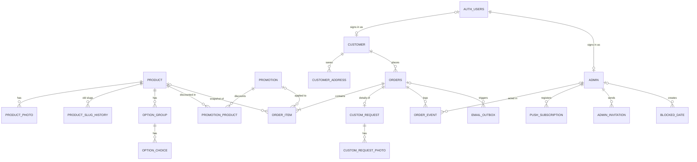

# Data Model — Aux petits bonheurs

Database: PostgreSQL (Supabase, one project per environment) · ORM: Drizzle · Updated: 2026-11-10 (feature-spec consolidation)
Tenancy: single-tenant (one bakery). Authorisation lives in app code (see "Access control"); RLS is enabled deny-all as a safety net.
Sources: build-brief "Data the app keeps" + Promotion, PRD FR-001..075 and NFR-003/004/005/013, ADR-0001. Code: `src/app/db/schema.ts` (barrel) → `src/app/db/tables/*.ts`; invariants tested in `src/app/db/schema.test.ts`.

## Conventions
- IDs: `uuid` (`gen_random_uuid()`), except `order_event` (bigint identity, append-only) and `settings` (singleton `id = 1`).
- Money: `integer` whole Mauritian rupees, columns suffixed `_rs`. Single currency (MUR), so no currency column (brief: whole rupees only).
- Time: `timestamptz` stored in UTC. Calendar concepts (order date, blocked days, seasonal window, quote expiry day) are `date` values **in Indian/Mauritius time**; conversions happen only in `app/domain/time.ts`.
- EN/FR text: short customer-facing fields are column pairs `*_en` (NOT NULL where required) and `*_fr` (nullable; NULL falls back to EN, NFR-007). Long or structured Settings content is `jsonb` of shape `{ "en": string, "fr"?: string }`, validated by zod on write.
- Phones in E.164 (`+230…` default); emails stored lower-cased.
- `created_at` / `updated_at` on mutable tables; `updated_at` set by the app.

## Entity diagram

Standalone: `gallery_photo`, `settings` (1 row), `counter`, `rate_limit_bucket`, `job_run`.

## Entities

### product
| Field | Type | Null | Default | Constraints / notes |
|---|---|---|---|---|
| id | uuid | no | gen | PK |
| slug | text | no | | UNIQUE; URL `/menu/:slug`; previous values kept in `product_slug_history` (301) |
| type | enum `product_type` (cake, cupcake_box, dessert, seasonal) | no | | menu filter |
| category | text | yes | | free label (e.g. "Birthday"); promotion link target |
| name_en / name_fr | text | no / yes | | |
| description_en / description_fr | text | yes | | |
| base_price_rs | integer | no | | CHECK ≥ 0 |
| allergens | text[] | no | `{}` | tags (eggless, nut_free, …) |
| notice_days | smallint | yes | | CHECK 0..60; NULL = Settings default |
| min_quantity | smallint | yes | NULL | CHECK NULL or 1..50; minimum units per basket line (e.g. dessert cups by 6); NULL = no minimum. Checked by `domain/pricing.ts` on add, update and submit (owner 2026-11-10: none set at launch) |
| status | enum `product_status` (available, sold_out, hidden) | no | available | |
| sort_order | integer | no | 0 | drag reorder |
| seasonal_starts_on / seasonal_ends_on | date (MU) | yes | | CHECK both NULL or both set and end ≥ start; inclusive |
| created_at / updated_at | timestamptz | no | now() | `updated_at` set by `admin/product` `save` |
| updated_by | uuid FK → admin | yes | | ON DELETE SET NULL; who saved last ("Updated by Sarah at 14:05", S-046; last write wins). Added by migration 0002 |
Indexes: (status, type, sort_order) — menu grid. Hard delete allowed (order items keep a snapshot, FK SET NULL); the UI prefers Hide.
The seasonal window is checked against the order's pickup/delivery date (`orders.fulfil_on`) at checkout, not the placement date (owner Q2, 2026-11-10); no schema change.

### product_slug_history
Added 2026-11-10 (owner Q19): a renamed product's old URL redirects (301) to the new one. Needs a Drizzle table in `src/app/db/tables/catalogue.ts` and a migration (expand-only).
| Column | Type | Null | Default | Notes |
|---|---|---|---|---|
| slug | text | no | | PK; an old slug of the product; also unique against `product.slug` (checked in the `save` transaction) |
| product_id | uuid FK → product | no | | ON DELETE CASCADE |
| created_at | timestamptz | no | now() | when the slug was replaced |
Written in the same transaction as a slug change in `admin/product` `save`. The public `/menu/:slug` loader looks up `product.slug` first, then this table. Returning to a previous slug removes that row from history.

### product_photo
id uuid PK · product_id FK → product ON DELETE CASCADE · storage_path text (bucket `public-images`) · variant_widths smallint[] NOT NULL default '{}' (S-276: widths of the 480/960 px copies stored beside it as `<stem>-<width>w.<ext>`; empty = original only) · width, height int · sort_order smallint CHECK 0..4 · UNIQUE (product_id, sort_order) — **caps 1–5 photos in the DB**; "at least 1" is enforced by the app when status ≠ hidden. Alt text = product name (NFR-002).

### option_group
id · product_id FK CASCADE · name_en/name_fr · kind enum `option_kind` (single, multiple, text, quantity) · required bool default false · text_max_length smallint (CHECK kind = 'text' or NULL; default from Settings = 40, FR-008) · quantity_min / quantity_max smallint (CHECK kind = 'quantity' or NULL; min ≤ max) · sort_order. Index (product_id, sort_order).

### option_choice
id · group_id FK → option_group CASCADE · name_en/name_fr · price_delta_rs integer default 0 (may be negative; line total CHECKed ≥ 0 on order_item) · sort_order. For `quantity` groups the delta is per unit.

### promotion
| Field | Type | Null | Notes |
|---|---|---|---|
| id | uuid | no | PK |
| title_en/_fr, text_en/_fr | text | en no, fr yes | |
| image_path | text | yes | bucket `public-images` |
| image_variants | smallint[] | no | default `{}`; widths of the stored 480/960 copies (S-053 AC8, S-276; migration 0020) |
| starts_at / ends_at | timestamptz | no | entered in MU time; CHECK ends_at > starts_at |
| active | boolean | no | default true; "end early" switch |
| placement | enum `promo_placement` (banner, card, both) | no | |
| link_kind | enum `promo_link` (none, product, category, custom_request) | no | default none |
| link_product_id | uuid | yes | FK → product SET NULL; CHECK set iff link_kind = product |
| link_category | text | yes | CHECK set iff link_kind = category |
| created_by | uuid | yes | FK → admin |
Live = `active AND starts_at ≤ now() < ends_at` (computed, never stored, so promotions start/end with no job, FR-016). Index (starts_at, ends_at) WHERE active.

### promotion_product
PK (promotion_id, product_id), both FK CASCADE · discount_kind enum (percent, sale_price) · percent_off smallint CHECK 1..99 · sale_price_rs integer CHECK ≥ 0 · CHECK exactly one of percent_off / sale_price_rs matches discount_kind. Lowest price across live promotions wins, never stacked (FR-017, `domain/promotions.ts`). As built (S-082, 2026-11-13): percent = floor((base x (100 - pct) + 50) / 100) (half up); a result at or above base is ignored; ties: earlier starts_at, then lower id. The same rule runs in SQL as `product_promotion(product_id, base, now)` (migration 0012), which `place_order` uses to price each line and fill `order_item.promotion_id`, `promotion_title_en` and `unit_base_price_rs`; a property test keeps the two in agreement.

### customer
| Field | Type | Null | Notes |
|---|---|---|---|
| id | uuid | no | PK |
| name | text | no | |
| phone | text | no | E.164; index (lookup for manual orders, FR-057) |
| email | text | yes | lower-case; **partial UNIQUE where not null** |
| locale | enum `locale` (en, fr) | no | default en |
| auth_user_id | uuid | yes | UNIQUE; → `auth.users.id` (Supabase), set when the customer has an account |
| admin_note | text | yes | private, admin-only (FR-065) |
| created_at / updated_at | timestamptz | no | |
"Account yes/no" = `auth_user_id IS NOT NULL`. Customer resolution follows contracts.md "Customer matching": website orders match by exact email only (else a new row), manual orders by email then phone; **no order path ever writes `email` or `auth_user_id` on an existing row** (contact data is snapshotted on the order; threat-model G-02). Phone is therefore not unique, and one person may have two rows (admins see both; acceptable). "Save my details" and sign-up (FR-034, FR-038) create an **unconfirmed** auth user with a random discarded password (threat-model G-01); `auth_user_id` is set on the customer row with that email **when the email is confirmed** (`auth/confirm` type=signup, `WHERE auth_user_id IS NULL`), which then links all past orders. Before confirmation nothing is linked, so a guest order placed under someone else's email cannot reveal their history. My orders also requires `lower(orders.contact_email)` = the confirmed email (or `source = manual`).

### customer_address
id · customer_id FK CASCADE · label text · address text · landmark text · is_default bool · created_at. Index (customer_id) · partial UNIQUE (customer_id) WHERE is_default (one default per customer; the app clears the old default in the same transaction).

### admin
| Field | Type | Null | Notes |
|---|---|---|---|
| id | uuid | no | PK = `auth.users.id` |
| name, email | text | no | email UNIQUE |
| role | enum `admin_role` (owner, admin) | no | |
| active | boolean | no | default true; checked on every admin request |
| alert_push / alert_email | boolean | no | default true (FR-046) |
| locale | enum locale | no | |
| last_sign_in_at, deactivated_at | timestamptz | yes | |
| sessions_revoked_at | timestamptz | yes | migration 0006 (S-032): set on deactivation and kept after reactivation; the admin guard refuses any session whose sign-in time (`amr`) is at or before it |
| created_at | timestamptz | no | |
Never hard-deleted (names stay on past events, FR-043). Last-owner rule (FR-044): enforced in the role/deactivate action inside a transaction that locks `admin` rows (`SELECT … FOR UPDATE WHERE role='owner' AND active`) and refuses if the result would be zero. An auth user is either an admin or a customer, never both (checked at invite and sign-up).

### admin_invitation
id · email · name · role · locale (language of the email and accept page, default en; migration 0005) · token_hash text UNIQUE (SHA-256 of a 32-byte random token; plaintext only in the email) · invited_by FK → admin · expires_at timestamptz (= created + 7 days, FR-042) · accepted_at, revoked_at · created_at. Resend = revoke the open row + insert a new one; at most one unused (not accepted, not revoked) row per lower(email) (`admin_invitation_open_email_uq`, migration 0005), so a new invite revokes the old one first. Own table because Supabase invite links cannot live 7 days.

### orders (`order` is reserved)
| Field | Type | Null | Default | Notes |
|---|---|---|---|---|
| id | uuid | no | gen | PK |
| number | integer | no | | UNIQUE; from `counter` (below); shown as `prefix + lpad(number, 4)` → APB-0042 |
| number_prefix | text | yes | Settings prefix at insert (trigger `orders_number_prefix`) | migration 0007 (S-058 AC6): the prefix the order was placed with; existing orders back-filled; displays use it (Settings only for a row without one), so a prefix change never renumbers earlier orders |
| source | enum `order_source` (website, custom_request, manual) | no | | |
| status | enum `order_status` | no | | awaiting_payment (website orders start here since migration 0013: full payment by Juice at order), pending_approval, quote_needed, quote_sent, approved, in_preparation, ready_for_pickup, out_for_delivery, completed, declined, cancelled, closed |
| customer_id | uuid | no | | FK → customer RESTRICT |
| contact_name, contact_phone | text | no | | snapshot at placement |
| contact_email | text | yes | | manual orders may omit |
| fulfilment | enum (delivery, pickup) | no | | |
| address, landmark | text | yes | | CHECK fulfilment = 'pickup' OR address IS NOT NULL |
| fulfil_on | date (MU) | no | | |
| time_window | jsonb | no | | snapshot `{ id, start: "09:00", end: "12:00", label: {en,fr} }` |
| items_total_rs, delivery_fee_rs, total_rs | integer | no | | CHECK ≥ 0; fee 0 for pickup |
| total_overridden | boolean | no | false | admin override on edit (FR-053) |
| paid | boolean | no | false | |
| paid_at / paid_by | timestamptz / uuid | yes | | FK → admin; set with `paid` |
| customer_note, admin_note, decline_reason | text | yes | | admin_note private |
| locale | enum locale | no | | language of every email for this order (FR-001) |
| tracking_token | text | no | | UNIQUE; 32 random bytes base64url (43 chars, 256 bits) — never derived from `number` |
| idempotency_key | uuid | yes | | UNIQUE; generated per checkout, custom-request and admin manual-order form render (FR-023) |
| policies_accepted_at | timestamptz | yes | | website/custom orders (FR-022) |
| pending_alert_sent_at | timestamptz | yes | | FR-075 sent-once marker |
| payment_reminder_sent_at | timestamptz | yes | | 0013 (S-280): the 12 h unpaid reminder was queued (sent-once marker) |
| cancel_reason | text | yes | | 0013 (S-280): `unpaid` when the 24 h job cancelled it (admin "Cancelled: unpaid"); E-06 adds others |
| refund_due_rs | integer | yes | | 0013 (S-281): set to `total_rs` when a **paid** order is declined; CHECK ≥ 0 |
| refunded_at / refunded_by | timestamptz / uuid | yes | | 0013 (S-281): the refund was sent by Juice; FK → admin RESTRICT; CHECK `refunded_at` ⇒ `refund_due_rs` set |
| version | integer | no | 1 | optimistic concurrency (below) |
| created_at / updated_at | timestamptz | no | now() | |
Status groups (`domain/status.ts`, contracts.md Conventions): *active* = not declined/cancelled/closed (calendar, Today, customer order count); *confirmed* = approved, in_preparation, ready_for_pickup, out_for_delivery, completed (prep list, evening reminder, unpaid list).
Indexes: (status, fulfil_on) — tabs, Today, counts · (fulfil_on) WHERE status NOT IN (declined, cancelled, closed) — calendar, prep list · (customer_id, created_at DESC) — My orders, customer detail · (created_at) WHERE status = 'pending_approval' AND pending_alert_sent_at IS NULL — FR-075 cron. Search by name/phone/number is ILIKE on a small table (≤ ~12k rows/year); add `pg_trgm` only if it measures slow.

### order_item
id · order_id FK CASCADE · product_id FK → product SET NULL (NULL for manual free-text items) · name_en / name_fr (snapshot) · original_base_price_rs · unit_base_price_rs (after promotion) · promotion_id FK → promotion SET NULL + promotion_title_en snapshot (FR-017) · options jsonb `[{ groupId, group:{en,fr}, kind, choiceId?, choice?:{en,fr}, priceDeltaRs, quantity?, text? }]` (S-092, migration 0010: one entry per chosen choice, plus one per filled text group; `priceDeltaRs` is the choice's delta per unit (a quantity entry also has `quantity`); unit price = `unit_base_price_rs` + Σ `priceDeltaRs` x (`quantity` ?? 1), and `line_total_rs` = unit price x `quantity`) · cake_message text · quantity int CHECK > 0 · line_total_rs int CHECK ≥ 0 · sort_order. Index (order_id), (product_id) for top-5 products. All prices are **copied** at placement (FR-012); later product edits never touch these rows.

### custom_request (1:1 with an order of source custom_request)
order_id uuid PK + FK → orders CASCADE · occasion, flavours, theme, cake_text, details text · servings smallint · budget_rs int · quote_amount_rs int · quote_note text · quote_expires_on date (MU; valid through 23:59 that day) · quote_sent_at timestamptz · quote_sent_by FK → admin. CHECK quote fields all NULL or amount + expiry set. Status lives only on `orders.status` (no duplicate). Re-quote overwrites the quote columns and logs the old values in an order_event (FR-033).

### custom_request_photo
id · order_id FK → custom_request CASCADE · storage_path (bucket `request-photos`, private) · sort_order CHECK 0..4 · UNIQUE (order_id, sort_order) — caps 5 (FR-029) · source_gallery_photo_id FK → gallery_photo SET NULL ("Request something similar").

### order_event (append-only)
id bigint identity PK · order_id FK CASCADE · actor_type enum (admin, customer, system) · actor_admin_id FK → admin RESTRICT (CHECK set iff actor_type = admin) · type text (created, approved, payment_received, payment_undone, payment_reminder_sent, refunded, declined, cancelled, quote_sent, quote_accepted, quote_declined, quote_expired, status_advanced, status_reverted, marked_paid, marked_unpaid, edited, email_failed, pending_alert_sent) · from_status / to_status order_status · details jsonb (e.g. edit diff, reason) · created_at. Index (order_id, created_at). Written in the **same transaction** as the change it records (NFR-013).

### gallery_photo
id · storage_path (public-images) · variant_widths smallint[] (S-276, as product_photo) · width, height · occasion text · caption_en/_fr · sort_order · created_at. Index (occasion, sort_order).

### blocked_date
id · starts_on date · ends_on date (CHECK ≥ starts_on; single day = equal) · reason text (private) · created_by FK → admin SET NULL · created_at. Index (starts_on, ends_on). Blocking never touches orders; the action returns the orders on those dates as a warning (FR-059).

### site_page (E-13 S-245; migration 0008)
One row per brand page, `key` in (`our_story`, `workshops`, `gallery`, `contact`, `custom_order`) (check). `content jsonb` = `{ <field>: { en, fr? } }` for the page's fields (our_story, workshops, custom_order: intro, body; gallery: intro; contact: intro, hours, pickup_note), validated at the write boundary (intro ≤ 300, others ≤ 10,000 per language). `event jsonb` = Workshops next workshop `{ title: { en, fr? }, date, seats, text }` or null. `is_placeholder` (true until the first save: noindex, out of the sitemap, "Sample text" in admin), `version` (FR-054 style), `updated_at`, `updated_by → admin` (never sent to the public read). Seeded with neutral EN/FR sample text (`ON CONFLICT DO NOTHING`). RLS on, no policies: written only by the `admin/page-editor` action.

### site_page_photo (E-13 S-247)
`page_key → site_page (cascade)`, `role` (`page` or `event`), `storage_path` (unique, `site/pages/<key>/<adminId>/<session>/<uuid>.<ext>`), `variant_widths` (S-276, as product_photo), `width`, `height` (> 0), `alt_en` (required), `alt_fr`, `sort_order`. Unique (`page_key`, `role`, `sort_order`); a check holds the per-page limits (our_story 0..3, workshops 0..5, custom_order 0..2, one `event` photo on workshops only). RLS on, no policies.

### review (E-14 S-261; migration 0018)
`customer_id → customer (cascade)` unique (one review per account) · `rating` smallint 1..5 (check) · `comment` text, 1..1000 characters, stored trimmed (check) · `display_name` text 1..80 ("Anna K.", from the profile when sent, refreshed when approved) · `locale` (the page language it was written on) · `status` enum `review_status` (`pending`, `approved`, `rejected`, `hidden`; moves in `domain/review.ts`) · `decided_by → admin (set null)`, `decided_at` · `version` int (decisions name the version they saw: `REVIEW_CHANGED`) · `created_at`, `updated_at`. No email, phone, address or order link. Indexes: `(decided_at desc) where status = 'approved'` (public read and aggregate), `(status, updated_at desc)` (admin tabs and the pending count). RLS on, no policies.

### review_event (E-14 S-263 AC8)
`review_id` (no FK: the line outlives a deleted review) · `action` enum `review_action` (`approve`, `reject`, `hide`, `show`, `delete`, `undo`) · `admin_id → admin (set null)` · `created_at`. Never the comment or a name. RLS on, no policies.

### settings (singleton)
id smallint PK CHECK id = 1 · default_notice_days smallint (3) · closed_weekdays smallint[] (ISO 1–7; default {7} = Sunday) · delivery_windows, pickup_windows jsonb `[{id,start,end,label:{en,fr}}]` · delivery_fee_rs (200) · pickup_address, pickup_map_url, contact_phone, contact_whatsapp, contact_email, juice_name, juice_number, payment_whatsapp, instagram_url text (juice_name, juice_number, payment_whatsapp: Juice payment, 0013/S-277, Owner-only, shown only on an order's token pages, never public) · hero jsonb (tagline {en,fr}, image_path) · featured_product_ids uuid[] · about, faq, policies, privacy_note jsonb (localized `{en, fr?}`; `faq` is one text per language since S-059, its default `[]` reads as none) · about_image_path · hero_image_variants, about_image_variants smallint[] (S-276: widths of the stored copies of the hero and About images; empty = original only) · whatsapp_templates jsonb (`{approved, ready, on_the_way, payment_reminder, blank}` each {en,fr}) · quote_validity_days smallint (5) · cake_message_max smallint (40) · evening_reminder_at text ('18:00') · order_number_prefix text ('APB-') · version int · updated_at, updated_by. Seeded by migration with the PRD A1 defaults.

### System tables
- **counter** (name text PK, value int): row `order_number`. Allocation `UPDATE counter SET value = value + 1 WHERE name='order_number' RETURNING value` runs **inside the order-insert transaction**, so a rollback releases the number: gap-free and race-free (row lock serialises; fine at this volume). A Postgres sequence was rejected because rolled-back `nextval` leaves gaps (NFR-013).
- **email_outbox**: id · template text · to_email · locale · payload jsonb · order_id FK SET NULL · dedupe_key text UNIQUE (e.g. `order:<id>:confirmed:v<version>`) · status enum (pending, sent, dead) · attempts smallint · next_attempt_at · last_error · provider_id · created_at, sent_at. Index (next_attempt_at) WHERE status = 'pending'. Rows are inserted in the business transaction; sending happens after commit (FR-074).
- **push_subscription**: id · admin_id FK CASCADE · endpoint text UNIQUE · p256dh, auth text · user_agent · failure_count · created_at, last_success_at. Deleted on HTTP 404/410 from the push service.
- **storage_purge** (S-045, migration 0003): PK (bucket, path) · attempts smallint · last_error text · created_at · due_at timestamptz NOT NULL DEFAULT now() (0016, E-08: not removed before it; indexed). Storage objects whose removal failed (a deleted product's photos); the hourly `purgeStorage` job retries them and deletes the row once the object is gone. No FKs (the referencing rows are already deleted). RLS on, no policies (server only).
- **rate_limit_bucket**: PK (key, window_start) · count int. Key = `<action>:<sha256(ip|email)>`. Fixed windows, purged hourly.
- **usage_counter** (S-217, migration 0017): PK (day, event, props) · count int. Server-side account usage counts per Mauritius day; `props` is a short `k=v;k=v` of the allowed properties (method, linkedOrders, skippedCount, atCheckout). No personal data, no user id. RLS on, no policies.
- **job_run**: PK (job, run_key) · ran_at. `INSERT … ON CONFLICT DO NOTHING` makes cron jobs once-only (e.g. `evening_reminder` / `2026-11-12`).

## Invariants
- DB-enforced: unique order number and tracking token; idempotency key unique; 1–5 photo caps (sort_order range + unique); delivery needs an address; money ≥ 0; promotion window and discount shape; seasonal window shape; actor_admin_id present for admin events; one settings row.
- App-enforced (in `app/domain`, unit-tested, then called by every action): status transitions (PRD Appendix B), price recalculation, availability, promotion selection, last active Owner, quote expiry, customer cancel only in pending_approval / quote_needed.

## Optimistic concurrency (FR-054)
Every order mutation sends the `version` the admin's screen loaded (hidden form field). The write is
`UPDATE orders SET …, version = version + 1, updated_at = now() WHERE id = $id AND version = $v RETURNING *`.
Zero rows → transaction rolls back, action returns `409 ORDER_CHANGED` and the UI shows "This order changed, reload". Event, outbox and item rewrites share that transaction. Customer-side cancel / accept / decline also check `version` (taken from the tracking page). `settings` uses the same pattern; products are last-write-wins (single-editor content, accepted).

## Access control
- The Worker connects with the Supabase **pooler (transaction mode) connection string** through Drizzle (`postgres` driver, `prepare: false`). This role bypasses RLS; **all authorisation is in the server loaders/actions** (architecture.md "Auth").
- **RLS is enabled on every table with no policies** so the public `anon` / `authenticated` keys (shipped to the browser for Supabase Auth) can read or write nothing through the Data API. Each Drizzle table calls `.enableRLS()`; `schema.test.ts` fails if any table lacks it.
- Storage: bucket `public-images` (product, gallery, promotion photos; public read, writes only via server-issued signed upload URLs); bucket `request-photos` (private; customer uploads via signed upload URL; admins view via short-lived signed URLs). Both buckets restrict MIME to `image/jpeg, image/png, image/webp` and size to 1 MB after client compression.

## Access patterns
| Query | Frequency | Index used |
|---|---|---|
| Menu grid (available/sold_out, by type, sorted) | every menu view | product (status, type, sort_order) |
| Live promotions now | every page (banner), menu, product, home (one query cached 60 s per isolate; live judged per request) | promotion (starts_at, ends_at) WHERE active |
| Tracking page by token | per customer visit | orders.tracking_token UNIQUE |
| Admin tabs / Today / counts | every admin view | orders (status, fulfil_on) |
| Calendar month counts, prep list for a day | daily | orders (fulfil_on) partial |
| Availability check (blocked dates in range) | each date picker / submit | blocked_date (starts_on, ends_on) |
| Customer by email / phone | manual order, guest checkout | customer email partial unique, phone |
| Activity log | order detail | order_event (order_id, created_at) |
| Pending > 24 h, expired quotes, due emails | hourly cron | orders partial, (status, fulfil_on), email_outbox partial |
| Sales summary for range | weekly | orders (status, fulfil_on) + order_item (product_id) |

Expected volume: < 1k orders/month, ~5 items each, ~10 events each → under 200k rows/year, well inside 500 MB.

## Data classes & retention
Regime: Mauritius DPA 2017 (`privacy.regions: [mu]`, **to confirm with owner, PRD Q12**). Periods below are proposals marked for owner review.

| Class | Examples | Retention | Deletion method |
|---|---|---|---|
| Customer personal | customer.name/phone/email, addresses, order contact snapshot, address | Orders kept 5 years after fulfil date (accounting) `[TO CONFIRM]`; then anonymised | Annual cron: null contact/address fields, replace name with "Deleted customer"; delete customer if no remaining orders |
| Customer on request | any of the above | Erase on request within 30 days | Owner-triggered anonymise action (same as above) |
| Reference photos | request-photos bucket | 90 days after the request reaches a final status (completed, declined, cancelled, closed = expired) `[TO CONFIRM]`; `RETENTION.requestPhotoDays` | Hourly `jobs/purge-storage`: the uploaded photos' `custom_request_photo` rows are deleted and their paths queued in `storage_purge` (due now) in one statement; gallery photos the customer picked stay (PRV-03) |
| Admin | name, email, last sign-in | While active + kept on events (legitimate interest) | Deactivate; never hard-deleted |
| Email outbox payloads and recipients | address, order ids, reasons | 90 days (finished rows; pending rows wait until sent or dead) | Daily cron (`jobs/purge-emails`): payload emptied, `to_email` cleared; the row stays so its dedupe key still blocks a resend (PRV-01) |
| Rate-limit keys | hashed IP/email | 1 day | Cron hard delete |
| Reviews | rating, comment, display name (public once approved) | Until the customer deletes it or the customer row is removed (cascade); retention after inactivity `[TO CONFIRM]` (PRD Q12) | Customer delete, admin delete on request, cascade |
| Push subscriptions | endpoint | Until failure or admin sign-out | Hard delete |
| Backups | full dump + storage | 8 weekly copies rolling | Workflow prunes oldest |
| Catalogue / content | products, gallery, settings | Indefinite (not personal) | Hard delete by admin |

## Migration plan
Greenfield: one initial migration generated by `drizzle-kit generate` (validated 2026-11-10: 23 tables, RLS on all; `product_slug_history` added after validation, so 24 at generation, FKs to `auth.users` without managing that schema; `schemaFilter: ["public"]`), followed by a hand-written SQL migration that (1) seeds `settings` (A1 defaults, windows, templates) and `counter('order_number', 0)`, (2) creates the two Storage buckets with MIME and size limits. Applied to staging first, then production, via `npm run db:migrate` (`/db-migration`). Later changes follow expand → backfill → contract; all tables are small, so lock risk is negligible.

## Migration log
| # | Date | Change | Expand/contract phase |
|---|---|---|---|
| 0000_initial | 2026-11-10 (generated, not applied) | Initial schema: 24 tables, RLS on all, no policies; includes `product.min_quantity`, `product_slug_history` and `customer_address_default_uq` (added before generation) | n/a (greenfield) |
| 0001_launch_seed | 2026-11-10 (hand-written, not applied) | Seeds `settings` (A1 defaults, Rs 200 delivery, pickup "Beau Bassin", **placeholder** Juice `5000 0000`), `counter('order_number', 0)`, Storage buckets `public-images` (public) and `request-photos` (private), 1 MB, jpeg/png/webp | data only |
| 0002_product_updated_by | 2026-11-12 (generated, S-046) | `product.updated_by` uuid NULL FK → admin ON DELETE SET NULL | expand only (nullable column) |
| 0003_storage_purge | 2026-11-12 (generated, S-045) | new table `storage_purge` (bucket, path) PK, RLS on | expand only (new table) |
| 0006_admin_sessions_revoked_at | 2026-11-12 (generated, S-032) | `admin.sessions_revoked_at` timestamptz NULL: sessions signed in at or before it are refused (deactivation signs out everywhere; reactivation does not revive old sessions) | expand only (nullable column) |
| 0007_orders_number_prefix | 2026-11-12 (generated + hand-written trigger, S-058) | `orders.number_prefix` text NULL, back-filled with the current Settings prefix; BEFORE INSERT trigger fills it from Settings when the insert names none | expand only (nullable column, back-fill, trigger) |
- 0008_site_pages (E-13 S-245): `site_page`, `site_page_photo` (additive, forward-only) and the placeholder seed. Applied by the staging deploy; production through the normal release.
- 0013_juice_payment (E-05 S-277..S-281, after promotions' 0012): `ALTER TYPE order_status ADD VALUE 'awaiting_payment' BEFORE 'pending_approval'`; `orders` adds `payment_reminder_sent_at`, `cancel_reason`, `refund_due_rs`, `refunded_at`, `refunded_by` (FK admin) and `orders_refund_ck`; `settings` adds `juice_name`, `payment_whatsapp`; `CREATE OR REPLACE PROCEDURE place_order` (the 0012 body with: insert as `awaiting_payment`, `created_at` from the input `now` (request clock), snapshot adds `juiceName`, `paymentWhatsapp`). Additive and forward-only; the new enum value is used only inside the procedure body (cast when it runs, after the migration commits), never in an index or check of the same transaction. No back-fill: existing orders keep their status (pending ones keep the Approve path). Rollback: a later migration restores the previous procedure body; columns stay. Applied by the staging deploy (CI).
- 0016_request_quotes (E-08 S-151, S-153, S-158): generated `orders.awaiting_payment_since` timestamptz NULL (an accepted quote enters the Juice payment flow days after the request: the 24 h deadline and 12 h reminder count from `coalesce(awaiting_payment_since, created_at)`), `storage_purge.due_at` (existing rows due at once) + index; hand-written `submit_custom_request` procedure: the whole custom request write in one CALL (replay by idempotency key; every photo path must hold an unexpired queue row in `request-photos`, which the same transaction deletes, so an attached photo is never purged; customer upsert, number, `orders` quote_needed with totals 0, `custom_request`, `custom_request_photo` sort 0..4 with the gallery photo first by reference, event `created`, outbox `request_received` and `admin_alert_new_request`). Additive, forward-only. A request photo upload is queued with `due_at` = issue + 24 h, so `purgeStorage` removes uploads no request took (S-153 AC7).
- 0011_photo_variants (E-04 S-276): `variant_widths smallint[] NOT NULL DEFAULT '{}'` on `product_photo`, `gallery_photo`, `site_page_photo`, and `hero_image_variants`, `about_image_variants` on `settings`. Additive, forward-only, expand only; existing rows read as "original only" until a new upload or the staging-only `photo-variants` backfill fills them. Rollback: a later migration drops the columns (the copies in Storage are then unused; removals already include them). 0012 is reserved for promotions.
- 0009_place_order_availability (E-05 S-083, S-084): `CREATE OR REPLACE PROCEDURE place_order` (no table change; grants kept): input `today`, snapshot adds the Settings date rules, blocked ranges (never the reason) and product notice/season, and no write on a date the rules refuse (mirrors `domain/availability.ts`). Rollback: a later migration restores the 0004 body. If another job also replaces `place_order` (E-05 pricing), the later-numbered migration must carry both changes.
- 0017_usage_counter (E-11 S-217; 0014 and 0015 were left unused when 0016 landed first): new table `usage_counter`. Additive, forward-only; rollback is a later migration dropping it (no page reads it).
- 0018_reviews (E-14 S-261): enums `review_status`, `review_action`; tables `review`, `review_event`. Additive, forward-only; rollback is a later migration dropping both tables and enums.
- 0021_place_order_account (E-11 S-212): `orders.by_account boolean NOT NULL DEFAULT false` (placed by a signed-in customer; My orders lists it) and `CREATE OR REPLACE PROCEDURE place_order` = the 0013 body plus `order.accountCustomerId` (a linked customer row wins over the email match). Additive; rollback restores the 0013 body.
