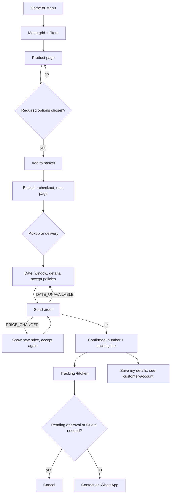

# UX Flow — Customer order (browse to tracking and cancel)

PRD: FR-001..008, 011..027, 070 · Journeys: J1, J2, J3, J12 · Specs: `catalogue-browsing`, `pricing-availability-promotions`, `checkout-and-tracking` · Persona: P1 customer, phone-first (375 px), often arriving from Instagram or WhatsApp · Critical journey: yes · Updated: 2026-11-10

## Goal
Order a cake or dessert without an account. Success = order saved as Pending approval, number + tracking link shown, "Order received" email sent. Customer understands it is not confirmed until the bakery approves.

## Entry points
- Instagram/WhatsApp link to `/menu` or `/menu/:slug` (share preview); home `/` ("Order now"); promo card or banner; gallery; reorder from `/account/orders`.
- First visit: language from phone (fr if French, else en); switch kept on same page (FR-001). Routes: `/x` (EN) and `/fr/x` (FR).

## Happy path

| # | Screen | User action | System response |
|---|---|---|---|
| 1 | `/menu` | Filter type/allergen (combine), tap card | Grid; sold-out label; hidden never shown |
| 2 | `/menu/:slug` | Pick options, message on cake (live count, max 40), quantity | Live price (server rules); "Earliest date: X"; Add disabled until required options set |
| 3 | `/basket` (one page) | Edit/remove lines; choose Pickup or Delivery | Subtotal; pickup address + map link, or delivery address + landmark + flat fee |
| 4 | same | Pick date | Calendar greys unavailable days; tap explains reason (blocked/closed/too soon) |
| 5 | same | Pick window, enter name/phone/email/note | Phone normalised to +230; signed-in prefilled |
| 6 | same | Tick policies, Send | Idempotent submit; spinner on button; no double order |
| 7 | `/order/:token/confirmed` | Read, copy link | Number APB-xxxx, "not confirmed until approved", tracking link, Save my details offer |
| 8 | `/t/:token` | Check status; Cancel if allowed | Progress bar, messages, WhatsApp button |

## Alternative and error paths
| Trigger | What the user sees | Recovery |
|---|---|---|
| Required option missing / message too long / below min quantity | Inline error under the field; focus to first error | Fix; input kept |
| Product sold out / hidden / out of season (at add or send) | `PRODUCT_UNAVAILABLE`: affected lines flagged in basket | Remove line or choose other product |
| Basket full (10 lines) | "Basket is full" | Remove a line |
| Date turned blocked/too soon after load | `DATE_UNAVAILABLE`: message at date field with reason | Pick another date; rest of form kept |
| Price changed since page load | `PRICE_CHANGED`: new lines and total shown, order not placed | Review, tick again, Send |
| Invalid phone/email/address | Inline field error | Fix |
| Policies unticked | Send blocked, error at checkbox | Tick |
| Bot check failed / rate limited | Friendly "Try again in a moment" (Retry-After) | Retry; input kept |
| Network/5xx on send | "We could not send your order. Nothing was lost; try again." Same idempotency key | Retry (no duplicate) |
| Empty basket | Empty state with "See the menu" and "Custom cake" buttons | Go to `/menu` |
| No results for filters | "Nothing matches" + Clear filters | Clear |
| Wrong/unknown tracking token | "Order not found" (same for both) | Link to home/WhatsApp |
| Cancel on Approved or later | No Cancel button; text: contact bakery on WhatsApp (policy: free until 48 h before) | WhatsApp; server refuses `CANCEL_NOT_ALLOWED` |
| Cancel and order changed meanwhile | `ORDER_CHANGED`: page refreshes with new status | Re-read |
| Declined order | Tracking shows decline reason | WhatsApp, or order again |
| Back / refresh on confirmation | Page reloads from token; basket already cleared | None needed |
| Second tab | Basket cookie shared; stale lines repriced at send | As price-changed |

## States per screen
- Loading: skeleton cards on menu (>300 ms); button spinner on Add/Send; tracking skeleton.
- Empty: basket, filtered menu, gallery by occasion.
- Permission: none required (public); tracking is token-only.
- Banner: dismissible per visit; ends automatically.

## EN/FR notes
Every label, error, email and policy exists in both; missing FR text falls back to EN. Order stores locale, so all emails follow it (J12). French strings run longer (~20%): buttons wrap, never truncate. Currency "Rs 1,250"; dates Mauritius time, locale formatted. Language switch preserves path and query.

## Screens involved
Home, Menu, Product, Basket/Checkout, Confirmation, Tracking, FAQ/policies (linked from tick box). Wireframes: `/wireframe customer-order` (prototype: `prototypes/apb-v1`).

## Accessibility notes
- Focus: on errors move to first invalid field + summary live region (`role=alert`); after Add to basket announce "Added, basket: n" via live region; on confirmation focus H1.
- Date picker keyboard operable, disabled days exposed with reason text, not colour only. Tap targets >= 44 px. Progress bar has text step ("Step 2 of 5: Approved").
- Cancel uses confirm dialog with focus trap and Esc to close.

## Analytics events (privacy-friendly, no cookies)
product_viewed, basket_added, checkout_started, order_sent, order_cancelled (aggregate counts only).

## Open questions
- Seasonal window judged on the pickup/delivery date (owner-approved Q2, 2026-11-10): the date picker offers only in-window dates for seasonal items; basket and checkout re-validate the chosen date.
